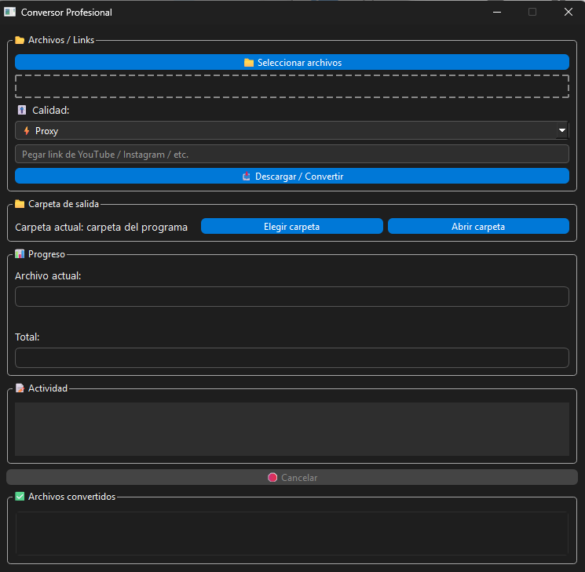

# Conversor Profesional

App de escritorio para convertir videos en lote a MP4 (H.264 + AAC). Arrastrás los archivos, elegís una calidad y la app se encarga del resto, con FFmpeg por debajo.



## Qué hace

- **Arrastrar y soltar** o seleccionar varios archivos a la vez: MP4, MKV, AVI, MOV, WEBM, MTS y MXF.
- **Cuatro presets de calidad:**

  | Preset | CRF | Velocidad | Uso |
  |---|---|---|---|
  | Proxy | 30 | ultrafast | Edición liviana |
  | YouTube | 23 | fast | Publicar en redes |
  | Alta calidad | 18 | slow | Masters |
  | Liviano | 28 | veryfast | Enviar o archivar |

- **Progreso real** por archivo y total, calculado leyendo la salida de FFmpeg.
- **Cancelar** una conversión en curso.
- **Carpeta de salida** configurable, con acceso directo para abrirla.
- **Descarga desde un link** con yt-dlp y conversión opcional al terminar.
- **.exe portable** para Windows con FFmpeg incluido, generado con PyInstaller.

## Cómo está armado

- `app.py`: interfaz en PySide6 (Qt) con tema oscuro.
- `worker.py`: `QThread` que ejecuta FFmpeg sin bloquear la interfaz y emite señales de progreso, estado y errores. Detecta si corre como .exe para usar el FFmpeg empaquetado.

## Ejecutar desde el código

Requiere Python 3.10 o superior y FFmpeg en el PATH.

```bash
pip install -r requirements.txt
python app.py
```

## Generar el .exe

1. Copiá `ffmpeg.exe` y `ffprobe.exe` a una carpeta `bin/` en la raíz del proyecto.
2. Ejecutá:

```bash
pip install pyinstaller
pyinstaller app.spec
```

El ejecutable queda en `dist/`.

> Usá la descarga desde links solo con contenido propio o con permiso de su autor.

## Stack

Python · PySide6 · FFmpeg · yt-dlp · PyInstaller

## Autor

**Nicolás Coudouy** · Mar del Plata, Argentina
[nicolascoudouy.com.ar](https://www.nicolascoudouy.com.ar) · [LinkedIn](https://www.linkedin.com/in/nicocoudouy)